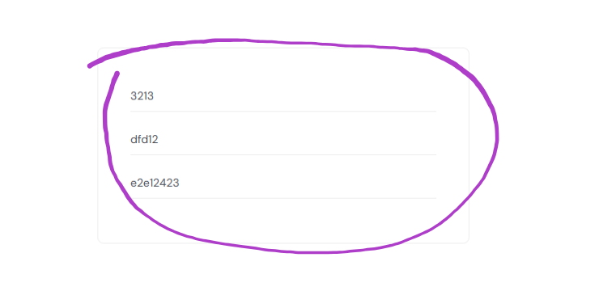
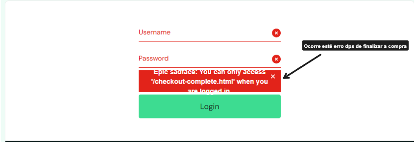

## BUG-01 - Campo de "Checkout: Your Information" bug- **Passos para reproduzir:**
  1. Fazer login com standard_user
  2. Adicionar um produto e ir ao checkout
  3. Digitar letras no campo de CEP
  4. Clicar em "Continue"
- **Resultado esperado:** o sistema recusar letras no CEP
- **Resultado atual:** o sistema aceitou e avançou para a próxima tela
- **Severidade:** Média

## BUG-02 - Sistema volta para o login ao finalizar a compra

- **Passos para reproduzir:**
  1. Fazer login com standard_user
  2. Adicionar um produto ao carrinho e clicar em "Checkout"
  3. Preencher os campos de dados do checkout com 
  4. Clicar em "Continue"
  5. Clicar em "Finish"
- **Resultado esperado:** o sistema deverá concluir a compra e mostrar "Thank you for your order"
- **Resultado atual:** o sistema voltou para a tela de login com a mensagem "Epic sadface: You can only access '/inventory.html' when you are logged in"
- **Reprodutibilidade:** ocorreu 1 vez; não reproduziu na segunda tentativa com dados válidos
- **Severidade:** Alta

